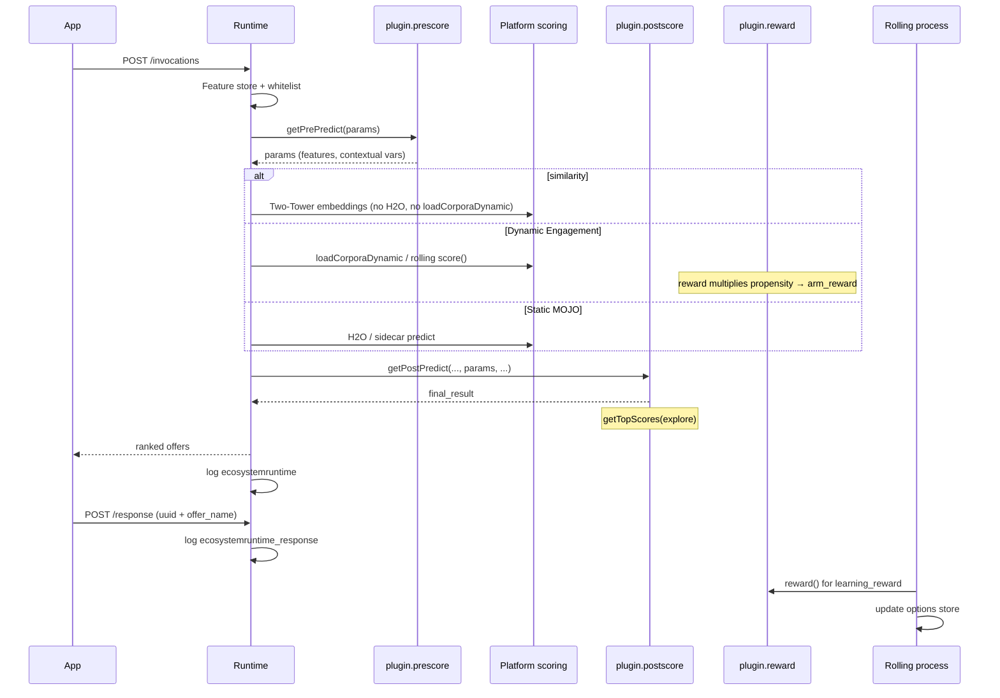

# ecosystem.Ai Runtime Guide

This guide explains **what the runtime is**, **how a request actually runs**, **how to pick pre-score and post-score classes**, **design decisions** (dynamic vs static vs Two-Tower), **how to review the algorithm in production**, and **how each algorithm converges**.

Java signatures and copy-paste templates live in [README.md](README.md). Algorithm IDs in this file match `ECOSYSTEM_ALGORITHMS.md` in the platform library. Do not invent `approach` / `sub_approach` names.

---

## Contents

1. [Runtime concept](#1-runtime-concept)
2. [Closed loop](#2-closed-loop)
3. [Stores and the rolling process](#3-stores-and-the-rolling-process)
4. [Execution sequence](#4-execution-sequence)
5. [Pre-score, post-score, and reward](#5-pre-score-post-score-and-reward)
6. [How to use pre-score and post-score](#6-how-to-use-pre-score-and-post-score)
7. [Product families and post-score pairing](#7-product-families-and-post-score-pairing)
8. [Algorithm convergence](#8-algorithm-convergence)
9. [Levers, epsilon, and non-convergence](#9-levers-epsilon-and-non-convergence)
10. [Design decisions](#10-design-decisions)
11. [Review algorithm type and performance](#11-review-algorithm-type-and-performance)

---

## 1. Runtime concept

The ecosystem.Ai runtime is a **headless scoring engine**. Callers (app, call centre, batch, another runtime) send a customer and campaign; the engine returns a ranked list of offers. It does not own the UI.

This localbuild project is the **customer overlay**. Scoring, rolling learning, MCP, ontology, and the dashboard ship in the `com.ecosystem:ecosystem-runtime` JAR. You customize behaviour with:

| Layer | Where | Role |
| --- | --- | --- |
| Campaign properties | `ecosystem.properties` | Plugins, models, Mongo, epsilon |
| Dynamic Engagement config | Mongo `ecosystem_meta.dynamic_engagement` | `randomisation.approach` / `sub_approach`, window, rewards |
| Options store | Dynamic Engagement options documents | Per-offer `alpha`, `beta`, `propensity`, `arm_reward` |
| Pre-score plugin | `plugin.prescore` | Enrich `params` before scoring |
| Post-score plugin | `plugin.postscore` | Build `final_result` for the caller |
| Reward plugin | `plugin.reward` | Shape `arm_reward` and learning weights |

The platform default Dynamic Engagement approach, when `approach` is missing, is **`binaryThompson`** (Ecosystem Rewards).

### What the runtime is not

- It is not a model-training notebook. H2O MOJOs are trained elsewhere and loaded here.
- It is not Workbench. Workbench configures campaigns; this process scores them.
- Dynamic Engagement `approach=Network` (PageRank on offers) is **not** Network Selector (routing traffic to another deployment).

### Families (pick this first)

| Family | Learns online from `/response`? | Typical post-score |
| --- | --- | --- |
| **Dynamic Engagement** | Yes — options store + rolling process | `PlatformDynamicEngagement` |
| **Static H2O / sidecar** | No (unless you add DE on top) | `PostScoreBasic`, `PostScoreRecommender*` |
| **Two-Tower / similarity** | No bandit loop; embedding retrieval | `PostScoreTwoTower` with `PrePredictTwoTower` |
| **Network Selector** | Routes to another runtime | `PostScoreNetwork` / `PostScoreNetworkSelector` |
| **Spend / Money Personality** | Domain APIs, not a DE `approach` | `PostScoreSpendingPersonality` (spend) |

If behaviour changes faster than you can retrain a MOJO, use Dynamic Engagement. If features are stable and you retrain weekly, use Static H2O. If the catalog is embeddings, use Two-Tower (`predictor.model.type=similarity`), not a DE `approach`.

---

## 2. Closed loop

Learning only happens when presentations and outcomes are both recorded.

```text
POST /invocations  →  ranked final_result (keep uuid + offer_name)
        │
        │  customer sees / accepts an offer
        ▼
POST /response     →  same uuid + offer_name  (singular — never /responses)
        │
        ▼
Rolling process    →  updates options store (α/β, Q, graph, …)
```

| Call | Purpose |
| --- | --- |
| `POST /invocations` | Score. `params` is a **JSON string** (`"{}"` or `{"input":[...],"value":[...]}`), not a nested object. |
| `POST /response` | Outcome. Match the row with that invoke’s `uuid` and `offer_name`. |

Without `/response`, pre-score and post-score still run, but the rolling process sees only presentations (or nothing). Scores freeze at the prior. `learning_reward` has no effect.

Optional: `POST /learning` with `{ "campaign": "..." }` triggers a rolling cycle without waiting for the scheduler.

---

## 3. Stores and the rolling process

Dynamic Engagement splits **write** (learn) from **read** (score).

```text
ecosystemruntime            presentations (every /invocations)
ecosystemruntime_response   accepts (every /response)
        │
        │  scheduler / POST /learning
        ▼
Rolling processor (by approach)  ──►  options store
        │                              arm_reward, alpha, beta, propensity
        ▼
Next /invocations reads options  ──►  post-score ranks them
```

| Processor | `approach` |
| --- | --- |
| `RollingEcosystemRewards` | `binaryThompson`, `epsilonGreedy` |
| `RollingNaiveBayes` | `naiveBayes` |
| `RollingQLearning` | `QLearning` |
| `RollingNetwork` | `Network` (PageRank) |
| `RollingBehavior` | `behaviorAlgos` + a `sub_approach` |

Every rolling processor also writes a **platform Beta posterior** on the options store:

```text
alpha = alpha_zero + success_reward × successes
beta  = beta_zero  + fail_reward × failures
```

Ranking still uses each algorithm’s own score (`arm_reward`, propensity, Q, PageRank, factorised likelihood). Thompson Sampling **samples the stored Beta**; it does not add `success_reward` a second time.

**Tabular** algorithms (`binaryThompson`, `epsilonGreedy`, `QLearning`) can partition on `training_cell`. **Factorised** algorithms (`naiveBayes`, `behaviorAlgos`, `Network`) bin each field and never concatenate a cell.

---

## 4. Execution sequence

Two paths share the same plugins. **Invoke** is the hot path. **Learn** is the background path.



### Invoke path (`POST /invocations`) — step by step

1. **Bind campaign** — properties, plugins, and (for DE) `dynamic_engagement` for this `campaign`.
2. **Lookup** — feature store by `customer` / lookup key; optional whitelist.
3. **Pre-score** (`plugin.prescore`) — mutate `params` only. Typical work: set `contextual_variable_one` / `_two`, add date parts, load Two-Tower embeddings, attach contact history. Does **not** write `final_result`.
4. **Platform scoring**
   - Static: score MOJO / `api:` sidecar → probabilities, labels, clusters.
   - Dynamic Engagement: load options + corpora; rolling `score()` by `approach` / `sub_approach`; **reward plugin** `reward` multiplies propensity: `arm_reward = propensity × reward`.
   - Similarity: skip H2O and `loadCorporaDynamic`; embeddings already on `params` from `PrePredictTwoTower`.
5. **Deployment epsilon** — with probability `predictor.epsilon`, `explore=1` (uniform random before ranking). This is separate from algorithm ε (see [§9](#9-levers-epsilon-and-non-convergence)).
6. **Post-score** (`plugin.postscore`) — the only place that **assembles the API response**. Reads model output or options `arm_reward`, applies eligibility, pricing, product payload, sorts, then `getTopScores`.
7. **Log** — write the invoke to `ecosystemruntime` (including `learning_reward` on the offer row when present).
8. **Return** `final_result` by rank. Caller must keep each row’s `uuid` and `offer_name`.

### Learn path (`POST /response` + rolling)

1. Match `uuid` + `offer_name` to the logged invoke (`offer` / `offer_treatment_code` also accepted).
2. Write `ecosystemruntime_response`.
3. On the next rolling cycle (scheduler `monitoring.delay`, or `POST /learning`):
   - Count presentations and accepts in the processing window.
   - Call **reward plugin** for `learning_reward` and optional `learning_for_contacts` / `learning_for_responses`.
   - Update α/β, propensity, Q-table, or graph.
   - Write options store so the **next** invoke ranks from new `arm_reward`.

Pre-score does not run on `/response`. Post-score does not run on `/response`. Reward runs on both the DE score path (per option) and the rolling learn path.

---

## 5. Pre-score, post-score, and reward

| Plugin | When | Input | Must produce | Does not |
| --- | --- | --- | --- | --- |
| **Pre-score** | Every invoke, after feature store | `params` | Same `params`, enriched | Rank offers |
| **Post-score** | Every invoke, after scoring | `predictModelMojoResult` + `params` | `final_result` array | Train the bandit |
| **Reward** | DE score (per option) and rolling learn | `params` | `params.rewards.reward` and `learning_reward` | Build `final_result` |

### Pre-score (prepare)

Configure `plugin.prescore`. Required. Loader tries `getPrePredict(MongoClient, JSONObject, CqlSession)` first, then `getPrePredict(JSONObject, CqlSession)`.

Use it to:

- Map feature-store fields onto Dynamic Engagement contextual variables.
- Add model features (`PrePredictAutoDate` date parts; virtual variables via `PreScoreDynamic`).
- Load embeddings (`PrePredictTwoTower`).
- Attach history for post-score (`PreScoreLookup` → `prescore_data_lookup`).

Copy `DefaultPreScore` for a no-op. Preserve `uuid`, `userid`, `lookup`, `resultcount`, `explore`.

### Post-score (decide what the caller sees)

Configure `plugin.postscore`. Required. Signature is always:

```text
getPostPredict(predictModelMojoResult, params, session, models)
```

This is the **use of post-score**: turn platform numbers into offers the product can show and later acknowledge.

Each `final_result` row needs at least `offer` / `offer_name`, `score`, and `uuid`. Dynamic Engagement rows should also carry `arm_reward`, `alpha`, `beta`, `learning_reward`. Call `getTopScores(params, predictModelMojoResult)` unless Network Selector `lookup_passthrough`.

What post-score typically does:

1. **Select candidates** — Dynamic Engagement options, model domains, offer matrix, or a routed campaign.
2. **Filter** — contextual-variable match, `eligible_offers`, location/time, whitelist.
3. **Price / value** — `offer_value`, `cost`, margin-adjusted `modified_offer_score`.
4. **Rank** — DE: sort by `arm_reward`. MOJO: sort by model `score`. Two-Tower: cosine/dot product from `SimilarityScorer`.
5. **Explore/exploit** — `getTopScores` honours `explore` and `resultcount`.
6. **Shape the payload** — product object (`PlatformDynamicEngagementProduct`), personality fields, or Network Selector URL.

Post-score does **not** update α/β. If ranking looks wrong, check options `arm_reward` and `/response` matching first; then check post-score filters hiding arms.

### Reward (shape value)

Configure `plugin.reward` (defaults to `DefaultReward`). Independent of internal `RewardStrategy` (Thompson sample vs ε-greedy rate).

| Field | Path | Effect |
| --- | --- | --- |
| `reward` | Invoke / DE score | `arm_reward = algorithm_score × reward` |
| `learning_reward` | Rolling learn | Weights that historical event in α/β or Q updates |
| `learning_for_contacts` / `learning_for_responses` | Rolling learn | Whether presentations, accepts, or both are weighted |

`DefaultReward` leaves both multipliers at `1.0`. Use a custom plugin when take-up is not equal (margin, VIP, Q-Learning payoff). See README [Reward Plugins](README.md#reward-plugins).

---

## 6. How to use pre-score and post-score

Set both class names on the campaign. Rebuild the localbuild JAR after you change Java. Switching between classes that are already compiled only needs a properties change (or `POST /refresh`).

```properties
plugin.prescore=com.ecosystem.plugin.customer.PreScoreDynamic
plugin.postscore=com.ecosystem.plugin.customer.PlatformDynamicEngagement
```

You only run **one** pre-score class and **one** post-score class per campaign. Combine behaviours by copying a shipped class and adding logic — do not list two class names.

### Recommended stacks (start here)

| What you are building | `plugin.prescore` | `plugin.postscore` | `plugin.reward` | Also configure |
| --- | --- | --- | --- | --- |
| Online learning recommender (default) | `PreScoreDynamic` | `PlatformDynamicEngagement` | `DefaultReward` | `randomisation.approach=binaryThompson`; close the loop with `/response` |
| Same, but return offer-matrix product JSON | `PreScoreDynamic` | `PlatformDynamicEngagementProduct` | `DefaultReward` | Offer matrix loaded |
| Sequential journeys | `PreScoreDynamic` | `PlatformDynamicEngagement` | Custom / `QLearnRewardPlugin` | `approach=QLearning`; Lookup Parameters |
| Engagement fatigue (not NBO) | `PreScoreDynamic` | **`PostScoreSentimentalEquilibrium`** | `DefaultReward` | `behaviorAlgos` + `sentimentalEquilibrium` |
| One H2O/sidecar model | `DefaultPreScore` or `PrePredictAutoDate` | `PostScoreBasic` | unused | `mojo.key` |
| Model labels are offers | `DefaultPreScore` | `PostScoreRecommender` | unused | Multiclass/binomial MOJO |
| One model + offer matrix prices | `DefaultPreScore` | `PostScoreRecommenderOffers` | unused | Offer matrix with `offer_price` |
| One binomial model per product | `DefaultPreScore` | `PostScoreRecommenderMulti` | unused | All product MOJOs on the classpath |
| Two-Tower / similarity | **`PrePredictTwoTower`** | **`PostScoreTwoTower`** | unused | `predictor.model.type=similarity` |
| Route to another runtime | `DefaultPreScore` or `PreScoreDynamic` | `PostScoreNetwork` or `PostScoreNetworkSelector` | unused | Corpora `network` + `network_config` |
| Spend Personality | `DefaultPreScore` | `PostScoreSpendingPersonality` | unused | Personality REST / campaign |

### Pre-score — how to use each class

| Class | Use this when | Pair with | How to use properly | Do not |
| --- | --- | --- | --- | --- |
| `DefaultPreScore` | No extra features; or you will copy this class | Any post-score | Keep as a passthrough, or copy and put logic in `getPrePredict`. Extends `PreScoreSuper`. | Do not expect it to set contextual variables. |
| `PrePredictCustomer` | Same empty template | Any | Prefer `DefaultPreScore` for new work (`PreScoreSuper` helpers). | Do not add Mongo lookups here without switching to the 3-arg signature. |
| `PreScoreDynamic` | Dynamic Engagement with 1–2 contextual cells or virtual features | `PlatformDynamicEngagement*` | Set `predictor.param.lookup` including `dynamic_lookup`. API non-blank `in_params` win; otherwise named feature-store fields are copied onto `contextual_variable_one` / `_two`. | Do not use as Two-Tower pre-score. |
| `PreScoreLookup` | Post-score needs recent contacts/accepts | Any post-score that reads `prescore_data_lookup` | Mongo 3-arg signature. History lands on `params.prescore_data_lookup`. Copy a DE post-score if you need to consume it. | Do not assume `PlatformDynamicEngagement` reads this key unless you add that read. |
| `PrePredictAutoDate` | MOJO needs date parts | `PostScoreBasic` / `PostScoreRecommender*` | Adds `datetime_*` onto `featuresObj` **and** `input`/`value`. Keep those arrays in lockstep if you add more fields. | Do not use alone for Two-Tower or DE cells. |
| `PrePredictTwoTower` | `predictor.model.type=similarity` | **Only** `PostScoreTwoTower` | Mongo 3-arg. Loads `user_embedding` / item cache. Needs user embedding collection or `api:pytorch` sidecar / default lookup. | Do not pair with `PlatformDynamicEngagement`. |
| Custom (copy `DefaultPreScore`) | Segment → cell, derived features, eligibility list for post-score | Matching post-score | Mutate `in_params` / `featuresObj` only. Return `params` (never null). Preserve `uuid`, `userid`, `lookup`, `resultcount`, `explore`. | Do not write `final_result`. Do not open your own Mongo/Cassandra connections. |

**Pre-score checklist**

| Step | Proper use |
| --- | --- |
| 1 | Choose the row in the table above; set `plugin.prescore` to the **full class name**. |
| 2 | If you need Mongo (`PreScoreDynamic`, `PreScoreLookup`, `PrePredictTwoTower`), implement `getPrePredict(MongoClient, JSONObject, CqlSession)`. Otherwise the 2-arg form. |
| 3 | For DE, ensure `contextual_variable_one` / `_two` are set here or in invoke `params` so post-score `compareContextualVariableValues` can match options. |
| 4 | If you add keys to `featuresObj` for a MOJO, also append them to `input` and `value`. |
| 5 | Fail closed: log and return unmodified `params`. A throw here aborts the invoke. |

### Post-score — how to use each class

| Class | Use this when | Pair with pre-score | How to use properly | Do not |
| --- | --- | --- | --- | --- |
| `PlatformDynamicEngagement` | Almost all DE `approach` values | `PreScoreDynamic` | Iterate options, filter with `compareContextualVariableValues`, sort by `arm_reward`, call `getTopScores`. Eligibility via `in_params.eligible_offers`. Pricing from offer matrix. | Do not re-implement Thompson. Do not use for Two-Tower, Network Selector, or sentimental equilibrium. |
| `PlatformDynamicEngagementProduct` | Same, plus a `product` object per offer | `PreScoreDynamic` | Same loop; copies offer-matrix document onto each row. | Do not use if the caller only needs offer name + score. |
| `PostScoreSentimentalEquilibrium` | `behaviorAlgos` + `sentimentalEquilibrium` | `PreScoreDynamic` | Formats pre-computed equilibrium scores. | Do not use this to rank a catalog of offers. |
| `PostScoreBasic` | Generic MOJO (cluster, regression, multinomial, anomaly, Cox, embedding) | `DefaultPreScore` / `PrePredictAutoDate` | Copy this. Map `predictModelMojoResult.type` onto `offer` / `score`. Always `getTopScores`. | Do not use for DE options-store ranking. |
| `PostScoreBasicOfferMatrix` | MOJO + prices/costs from offer matrix | `DefaultPreScore` | Same as basic; read `offerMatrixWithKey`. | |
| `PostScoreBasicParallel` | Post-score must call another runtime/API | `DefaultPreScore` | Uses `ExternalRuntimeAsync`. Timeouts belong here, not in the controller. | Do not block the invoke on an unbounded HTTP call. |
| `PostScoreRecommender` | Model domains/labels **are** the offers | `DefaultPreScore` | Builds `final_result` from scored domains. | Do not use if offers live only in an options store (use DE post-score). |
| `PostScoreRecommenderOffers` | One multiclass model; all offers in the matrix | `DefaultPreScore` | Matrix must include every `offer_name` and `offer_price`. | Do not mix with per-product MOJOs (`PostScoreRecommenderMulti`). |
| `PostScoreRecommenderMulti` | One binomial MOJO **per product** | `DefaultPreScore` | Every matrix row needs its model loaded. | Do not use a single multiclass MOJO here. |
| `PostScoreRecommenderProduct` | Product recommender payload | `DefaultPreScore` | Personality-series template; carry product fields. | |
| `PostScoreNetwork` | Network Selector: route by a **feature** (`switch_key`) | `DefaultPreScore` or `PreScoreDynamic` | Corpora `network` + `network_config`. Skip `getTopScores` only for `lookup_passthrough`. | Do not confuse with DE `approach=Network` (PageRank). That uses `PlatformDynamicEngagement`. |
| `PostScoreNetworkSelector` | Network Selector: route by the **scored offer** | Same | `network_config.type=model_selector`. `switch_key` unused. | Same as above. |
| `PostScoreTwoTower` | Similarity / two-tower | **`PrePredictTwoTower`** | Delegates to `SimilarityScorer`, then `getTopScores`. | Do not use without the matching pre-score. |
| `PostScoreSpam` | Spam vs ham classifier | `DefaultPreScore` | Domain example. Copy only if that is the campaign. | Do not use as a generic recommender. |
| `PostScoreSpendingPersonality` | Spend Personality | `DefaultPreScore` | Calls personality REST; not a bandit. | Do not treat as Dynamic Engagement. |
| Custom (copy DE or Basic) | Extra eligibility, margin, packing | Matching pre-score | Keep `offer`, `offer_name`, `score`, `uuid` on every row. DE: also `arm_reward`, `alpha`, `beta`, `learning_reward`. Call `getTopScores`. Return the input object on error (never null). | Do not drop `offer_name` (breaks `/response`). Do not train α/β here. |

**Post-score checklist**

| Step | Proper use |
| --- | --- |
| 1 | Pick the family first (DE / MOJO / similarity / selector). Then pick the class in the table. |
| 2 | Set `plugin.postscore` to the **full class name**. |
| 3 | Put `final_result` on `predictModelMojoResult`. Each row: `offer`, `offer_name`, `score`, `uuid`. |
| 4 | DE campaigns: sort by `arm_reward`, keep MAB fields, use `compareContextualVariableValues`. |
| 5 | Call `getTopScores` so `numberoffers` and deployment epsilon apply (except selector `lookup_passthrough`). |
| 6 | If ranking is wrong, inspect options-store `arm_reward` and `/response` matching **before** rewriting post-score. |

### What you may change vs what you must not

| | Pre-score | Post-score |
| --- | --- | --- |
| **May** | `in_params`, `featuresObj`, `input`/`value`, extra keys for later plugins | Scores, prices, eligibility, sort, product payload, `final_result` |
| **Must keep** | `uuid`, `userid`, `lookup`, `resultcount`, `explore`, method signature | `getPostPredict` 4-arg signature; `offer` / `offer_name` / `uuid` on each row |
| **Must not** | Rank offers; return null; open new DB connections | Update α/β; skip `/response` identity fields; return null |
| **Call `getTopScores`?** | No | Yes (except Network Selector `lookup_passthrough`) |

Java method contracts: [README Pre-Score](README.md#pre-score-plugins) and [README Post-Score](README.md#post-score-plugins).

---

## 7. Product families and post-score pairing

Exact IDs. Behavioral types are **never** a top-level `approach`.

### Dynamic Engagement

Set `randomisation.approach` (and `sub_approach` when `behaviorAlgos`). Default plugins:

```properties
plugin.prescore=com.ecosystem.plugin.customer.PreScoreDynamic
plugin.postscore=com.ecosystem.plugin.customer.PlatformDynamicEngagement
plugin.reward=com.ecosystem.plugin.reward.DefaultReward
```

Use `PlatformDynamicEngagementProduct` when each offer must include the offer-matrix `product` object.

| `approach` | `sub_approach` | Post-score to use | Why that post-score |
| --- | --- | --- | --- |
| `binaryThompson` | — | `PlatformDynamicEngagement` | Reads sampled Beta as `arm_reward`; contextual-variable filter; `getTopScores` |
| `epsilonGreedy` | — | `PlatformDynamicEngagement` | Same options loop; ranking is empirical propensity × reward |
| `naiveBayes` | — | `PlatformDynamicEngagement` | Same loop; `arm_reward` is factorised P(offer\|features) × reward. Needs Lookup Parameters |
| `QLearning` | — | `PlatformDynamicEngagement` | Ranks Q-values as `arm_reward`. Needs Lookup Parameters + a real `plugin.reward` |
| `Network` | — | `PlatformDynamicEngagement` | Ranks PageRank scores. Co-occurrence graph; Lookup Parameters. **Not** Network Selector |
| `behaviorAlgos` | `lossAversion` (default) | `PlatformDynamicEngagement` | Options carry rebuilt behavioural `arm_reward` |
| `behaviorAlgos` | `riskAversion` | `PlatformDynamicEngagement` | Mean–variance utility on options |
| `behaviorAlgos` | `prospectTheory` | `PlatformDynamicEngagement` | Seeded drift scores on options |
| `behaviorAlgos` | `coverageAwareThompson` | `PlatformDynamicEngagement` | Thompson + long-tail boost on options |
| `behaviorAlgos` | `longTailBoostMF` | `PlatformDynamicEngagement` | WRMF scores on options |
| `behaviorAlgos` | `generative` | `PlatformDynamicEngagement` | LLM JSON scores stamped onto options; needs `randomisation.prompt` |
| `behaviorAlgos` | `sentimentalEquilibrium` | **`PostScoreSentimentalEquilibrium`** | Aggregate effort/sentiment — **not** per-offer NBO. Do not use `PlatformDynamicEngagement` expecting offer ranks |

`PlatformDynamicEngagement` is the post-score for almost every learning campaign because the rolling process has already written `arm_reward`. The plugin’s job is eligibility, pricing, and `getTopScores`, not re-implementing Thompson.

### Static H2O / sidecar

No options store. Post-score maps model type (multinomial, binomial, regression, clustering, …) onto offers.

| Situation | Post-score |
| --- | --- |
| Generic template | `PostScoreBasic` |
| Pricing from offer matrix | `PostScoreBasicOfferMatrix` |
| Labels are offers | `PostScoreRecommender` |
| One multiclass model + offer matrix | `PostScoreRecommenderOffers` |
| One binomial MOJO per product | `PostScoreRecommenderMulti` |
| Carry product fields | `PostScoreRecommenderProduct` |
| Async/external call in post-score | `PostScoreBasicParallel` |

Pre-score is usually `DefaultPreScore` or `PrePredictAutoDate`. Reward is unused unless you also run Dynamic Engagement.

### Two-Tower (`predictor.model.type=similarity`)

Not a DE `approach`. Pair:

```properties
plugin.prescore=com.ecosystem.plugin.customer.PrePredictTwoTower
plugin.postscore=com.ecosystem.plugin.customer.PostScoreTwoTower
```

Pre-score loads user/item embeddings. Post-score delegates to `SimilarityScorer` (cosine / dot product) then `getTopScores`. Do not mix with `PlatformDynamicEngagement`.

### Network Selector (traffic routing)

Not `approach=Network`. Additional corpora `network` + `network_config`.

| Class | Routes by |
| --- | --- |
| `PostScoreNetwork` | Feature `switch_key` (for example marital status) |
| `PostScoreNetworkSelector` | Scored offer (`type=model_selector`) |

Post-score replaces `final_result` with the downstream campaign’s offers (or a lookup passthrough). PageRank offer graphs stay on `approach=Network` + `PlatformDynamicEngagement`.

---

## 8. Algorithm convergence

Scores move only after `/invocations` (presentations) and `/response` (successes) fall inside the processing window. Platform **always returns offers**: no history → uniform random; partial history → mix of computed scores and random fallback.

### Comparison

| Algorithm | Convergence speed | Accumulated state | Persisted vs rebuilt | Cold start |
| --- | --- | --- | --- | --- |
| Ecosystem Rewards (`binaryThompson`) | Medium | Beta per offer × context × optional `training_cell` | **Persisted** | Excellent — Beta(1,1) when priors unset |
| Epsilon Greedy (`epsilonGreedy`) | Fast exploit once rates exist | Empirical propensity; Beta still written | **Persisted** | Moderate — arms tie at 0; rely on ε |
| Bayesian Probabilistic (`naiveBayes`) | Very fast when features inform | P(field\|offer) + Laplace; Beta alongside | Likelihood **rebuilt from window**; Beta persisted | Good (Laplace) |
| Q-Learning (`QLearning`) | Slow until states fill | Q-table (history + optional cell) × offers | Q **persisted**; Beta alongside | Random until Q fills |
| Network (`Network`) | Fast once the graph exists | PageRank on co-occurrence | Graph **rebuilt from window**; Beta persisted | Random until graph exists |
| Human Behavioral (`behaviorAlgos`) | See type | Type-specific in-memory scores | **Rebuilt every cycle** (`resetBehaviorAlgorithms`); platform Beta persisted | Depends on type |
| Loss Aversion | Medium–fast | Ignored-offer penalty + UCB | Rebuilt | Smoothing + UCB help unseen arms |
| Risk Aversion | Fast once history exists | Mean–variance utility | Rebuilt | No scores until history → random |
| Prospect Theory | Medium | Seeded values + drift | Rebuilt | Strong behavioural cold start |
| Sentimental Equilibrium | Single-shot | Aggregate sentiment/effort | Rebuilt / not a ranker | N/A for NBO |
| Coverage-Aware Thompson | Slow (coverage fights a single winner) | Thompson + 1/(exposure+1)^γ | Rebuilt behavioural; Beta-like sampling | Best fairness cold start (unseen get max boost) |
| Long-Tail Boost MF | Medium | WRMF/ALS factors | Rebuilt | Poor — needs matrix density |
| Generative | N/A | None (LLM per request) | Not accumulated | Prompt-driven; not statistical |

Defaults (algorithm ε / success / fail / prior success / prior fail):

| `approach` | epsilon | success_reward | fail_reward | prior_success | prior_fail |
| --- | --- | --- | --- | --- | --- |
| `binaryThompson` | 0.2 | 1 | 0.1 | 0.1 | 0.01 |
| `epsilonGreedy` | 0.1 | 1 | 0.1 | 0.1 | 0.01 |
| `naiveBayes` | 0.05 | 1 | 1 | 1 | 1 |
| `behaviorAlgos` | 0.2 | 1 | 1 | 1 | 1 |
| `QLearning` | 0.1 | 1 | 0.1 | 0.1 | 0.01 |
| `Network` | 0.05 | 1 | 0.1 | 0.1 | 0.01 |

Q-Learning also: `learning_rate` 0.25, `discount_factor` 0.75, `random_action` 0.2, `max_reward` 10.

### Per-algorithm notes (what post-score sees)

**`binaryThompson`** — Rolling writes α/β; at score time Thompson samples `Beta(alpha, beta)` then reward multiplies it. Post-score (`PlatformDynamicEngagement`) treats that sample as `arm_reward`. Inspect posterior **mean** `alpha/(alpha+beta)` when diagnosing; samples are stochastic by design. Priors are conjugate: `alpha_zero` / `beta_zero`.

**`epsilonGreedy`** — Rank by `response_count / logging_count` (then reward). ε% of the time the **algorithm** picks random; deployment ε can still force `explore=1` in post-score. Beta is written for inspection only.

**`naiveBayes`** — Bernoulli Naive Bayes, not multinomial. Fast convergence from discrete/binned features. Post-score still walks options; it does not read MOJO domains. Missing Lookup Parameters → empty inference.

**`QLearning`** — Bellman updates in rolling; post-score ranks Q as `arm_reward`. Without a reward plugin that returns real payoffs, Q stays near the default 1.0. Sparse per-customer states look like non-convergence.

**`Network`** — PageRank on co-presentation / co-acceptance. Post-score is still `PlatformDynamicEngagement`. Empty graph → random `arm_reward`. Do not pair with `PostScoreNetwork`.

**`behaviorAlgos`** — In-memory behavioural scores are discarded every rolling cycle and rebuilt from the window. The options Beta is what persists. Post-score is `PlatformDynamicEngagement` except **sentimental equilibrium**.

**`lossAversion`** — Failures hurt more than accepts help; UCB lifts under-sampled arms. Use when a bad offer is costly. Post-score: standard DE loop.

**`riskAversion`** — Steady uptake over peak conversion. Long windows (for example 30 days). No history → post-score sees random fallback.

**`prospectTheory`** — Seeds all offers, then adaptive drift. Slower to a single winner. Post-score: standard DE loop.

**`sentimentalEquilibrium`** — Contact fatigue / effort, **not** next-best-offer. Post-score **must** be `PostScoreSentimentalEquilibrium`. If you need offer ranks, pick a bandit instead.

**`coverageAwareThompson`** — “Unpopular recommender.” Coverage KPI will **slow** concentration on the global best. Post-score: standard DE loop; do not also crank ε if the boost is enough.

**`longTailBoostMF`** — WRMF × long-tail boost. Sparse logs → poor scores in post-score. Not for launch.

**`generative`** — LLM per invoke; scores are not accumulated. Post-score still formats options. Latency and cost sit on the invoke path.

### Priors (what “starting score” means)

| Algorithm | Prior |
| --- | --- |
| Ecosystem Rewards / Coverage-Aware Thompson | Conjugate Beta `alpha_zero`, `beta_zero` (options → `prior_success_reward` / `prior_fail_reward` → 1.0) |
| Epsilon Greedy | Same Beta fields for inspection; rank uses propensity |
| naiveBayes | Laplace α = 1 |
| Loss Aversion | Smoothing + UCB (not conjugate) |
| Prospect Theory | `baseDriftRate` seeding |
| Risk Aversion, Network, Long-Tail Boost MF | None — random until history |
| Q-Learning | None — random until Q fills |
| Generative | Prompt only |

Thompson prior weight after *n* events is `(α0+β0)/(α0+β0+n)`. Uninformative α0=β0=1 at n=10 is ~17% prior. Strong α0=10, β0=5 at n=10 is ~60% prior — data has not taken over. Huge `alpha_zero` looks like frozen arms.

---

## 9. Levers, epsilon, and non-convergence

### Three epsilon layers

1. **Deployment** (`predictor.epsilon`) — may set `explore=1` **before** post-score `getTopScores` (uniform random).
2. **Algorithm-internal** — Thompson Beta overlap, Loss Aversion UCB, Q `random_action`, Prospect internal ε, LLM temperature.
3. **Epsilon Greedy policy** — ε **is** the explore/exploit rule.

Do not raise all three at once when diagnosing exploration.

### Levers that change convergence

| Lever | Effect |
| --- | --- |
| `success_reward` / `fail_reward` | Larger → α/β move faster per event |
| `prior_*_reward` / `alpha_zero` | Stronger prior → slower data takeover |
| `processing_window` / `processing_count` | Shorter → faster adaptation, noisier |
| `decay_gamma` | Down-weight older repeats (`1.0` = none) |
| `interaction_count` | Cap per-customer events |
| Options `weighting` | Multiplies `arm_reward` at score (business boost, not learning) |
| Reward `learning_reward` | Scales the learning update; bugs look like non-convergence |
| Training-field binning | Unbinned numerics → unique cells, n=1, random |

### Diagnose before changing post-score

| Symptom | Likely cause | Fix |
| --- | --- | --- |
| Arms frozen at the prior | No `/response`, or huge α0/β0 | Match `offer_name`; modest priors; check rolling logs |
| All arms tied | Empty window; ε-greedy at 0; unique unbinned cells | Widen window; bin numerics; raise ε until n grows |
| One arm dominates | High `success_reward`; `weighting`; no coverage | Coverage-Aware Thompson; cap weighting |
| Scores never settle | Short window; high ε; Thompson sampling | Lengthen window; lower ε; inspect posterior mean |
| Behavioural scores “reset” | `resetBehaviorAlgorithms()` every cycle | Expected — look at the window, not yesterday’s in-memory state |
| Post-score empty `final_result` | Contextual-variable mismatch, eligibility, missing options | Log `compareContextualVariableValues`; check options store |
| Q never learns | Default `plugin.reward` or no `/response` | Implement payoffs; close the loop |

---

## 10. Design decisions

Decide the **family** before the plugin class or `approach` ID. The runtime can host all three on one process (different campaigns). Mixing families on **one** campaign (Two-Tower pre-score with Dynamic Engagement post-score, or a MOJO post-score on an options store) produces empty or meaningless `final_result`.

### Family choice

| If this is true | Choose | Why |
| --- | --- | --- |
| Take-up changes faster than you can retrain a MOJO (hours–days) | **Dynamic Engagement** | Options store + `/response` move α/β without a new artifact |
| Features and behaviour are stable; you already have AutoML/GBM | **Static H2O / sidecar** | One scored row per invoke; periodic `mojo.key` refresh |
| Catalog is large; you retrieve by embedding similarity | **Two-Tower** | `predictor.model.type=similarity`; no bandit loop |
| You must compare two live campaigns (champion / challenger) | **Network Selector** | `PostScoreNetwork*` routes traffic; not `approach=Network` |
| Next offer depends on prior accepts in the same journey | Dynamic + `QLearning` | Only if you can own `plugin.reward` |

Heuristic: **variable behaviour over time → dynamic**. **Stable behaviour + batch retrain → static**. **Millions of SKUs / cosine retrieval → Two-Tower**.

### What each family owns

| Concern | Dynamic | Static | Two-Tower |
| --- | --- | --- | --- |
| Source of truth for rank | Options store `arm_reward` (after rolling) | MOJO / sidecar probabilities | User·item embedding similarity |
| Learns from `/response` | Yes — required | No (unless you add a DE campaign later) | No |
| Retrain | Rolling window (`processing_window` / `processing_count`) | Offline AutoML; replace zip / `api:` | Re-export embeddings / `run_id`; `/refresh` invalidates item cache |
| Pre-score job | Cells, virtual features (`PreScoreDynamic`) | Date parts / feature hygiene | Load embeddings (`PrePredictTwoTower`) |
| Post-score job | Eligibility, price, `getTopScores` on options | Map model type → offers | `SimilarityScorer` then `getTopScores` |
| Reward plugin | Yes (`reward` × propensity, `learning_reward`) | Unused | Unused |
| Typical failure | Missing `/response`; wrong `offer_name`; empty window | Stale MOJO; feature mismatch | Missing user vector; stale item cache |

### Design rules (do not reverse these)

1. **Platform vs overlay** — algorithms, rolling processors, and `RewardStrategy` stay in the Maven JAR. Product differences are plugins + properties + `dynamic_engagement`. Do not fork `EcosystemMaster` per tenant.
2. **One scoring path per campaign** — set `plugin.prescore` / `plugin.postscore` as a pair from [§6](#6-how-to-use-pre-score-and-post-score). Compose by copying a class, not by stacking two post-scores.
3. **Closed loop is a product decision** — if the UI never calls `POST /response`, do not choose Dynamic Engagement and expect convergence. Static or Two-Tower are honest.
4. **Pre-score prepares, post-score decides, reward values** — ranking and `/response` identity (`offer_name`, `uuid`) belong in post-score. Training updates belong in rolling + reward, not in post-score.
5. **Contextual cells vs many features** — 0–2 discrete cells → `binaryThompson`. Many discrete attributes → `naiveBayes` + Lookup Parameters. Embeddings → Two-Tower, not extra contextual variables.
6. **Network Selector vs `Network`** — Selector is a **routing** design (another runtime URL). `approach=Network` is **PageRank on co-presented offers** inside one DE campaign.
7. **Sentimental equilibrium is not NBO** — if the KPI is offer rank, do not pick `sentimentalEquilibrium`. If the KPI is contact effort, do not use `PlatformDynamicEngagement`.
8. **Static + dynamic later** — a valid sequence is: ship a MOJO (`PostScoreBasic`), collect `/invocations` logs, then stand up a DE campaign on the same offers. Do not expect the static campaign’s post-score to read the options store.

### Choosing a Dynamic `approach` (after the family is DE)

Apply the first matching rule:

| # | Situation | Design |
| --- | --- | --- |
| 1 | User named an algorithm | Map to the exact ID (`binaryThompson`, not “Thompson”) |
| 2 | Generic online NBO / MAB | `binaryThompson` (platform default) |
| 3 | Catalog fairness / long tail | `behaviorAlgos` + `coverageAwareThompson` |
| 4 | Simple explainable A/B | `epsilonGreedy` |
| 5 | Many discrete features, accuracy over explore | `naiveBayes` |
| 6 | Sequential next-offer | `QLearning` + custom reward |
| 7 | High cost of a bad offer | `behaviorAlgos` + `lossAversion` |
| 8 | Regulated / stable uptake | `behaviorAlgos` + `riskAversion` |
| 9 | Bundles / co-occurrence | `Network` (PageRank) |
| 10 | LLM scores offers at invoke time | `behaviorAlgos` + `generative` (latency/cost) |

Greenfield with no logs: `binaryThompson` or `coverageAwareThompson`. Avoid `longTailBoostMF`, `Network`, `riskAversion`, and `QLearning` until there is history (or accept random until the table/graph fills).

---

## 11. Review algorithm type and performance

Review in two passes: **confirm the family actually running**, then **judge performance with the metrics that family can move**.

### Pass 1 — what is this campaign?

| Check | Dynamic | Static | Two-Tower |
| --- | --- | --- | --- |
| Properties | `plugin.postscore=...PlatformDynamicEngagement` | `mojo.key` set; post-score `PostScoreBasic` / `PostScoreRecommender*` | `predictor.model.type=similarity` |
| Pre / post pair | `PreScoreDynamic` + `PlatformDynamicEngagement*` | `DefaultPreScore` / `PrePredictAutoDate` + Basic/Recommender | **`PrePredictTwoTower` + `PostScoreTwoTower`** |
| Mongo | `ecosystem_meta.dynamic_engagement` → `randomisation.approach` | Feature store only | User/item embedding collections + `run_id` |
| `GET /campaigns/{id}` or `/validation/properties` | Approach, plugins, window | Plugin + mojo | Similarity / `api-ref` flags |
| Logs | `ecosystemruntime` **and** `ecosystemruntime_response` | `ecosystemruntime` (response optional) | `ecosystemruntime` (response optional) |

If `approach=behaviorAlgos` and `sub_approach` is empty, the runtime silently uses `lossAversion` — treat that as a review finding.

If post-score is `PostScoreNetwork*`, you are reviewing a **router**, not the downstream algorithm. Open the `url` / `campaign` in the network corpus and review **that** deployment.

### Pass 2 — performance (what “good” means)

| Question | Dynamic | Static | Two-Tower |
| --- | --- | --- | --- |
| Is rank changing with outcomes? | Options `alpha`/`beta`/`arm_reward` move after `/response` + rolling | Only after a new MOJO deploy | Only after new embeddings / `/refresh` |
| Primary KPI | Take-up per offer, regret, catalog coverage | Holdout AUC / logloss / lift vs random | Recall@k, cosine of the served item, default-lookup rate |
| Inspect | Posterior **mean** `alpha/(alpha+beta)`, not a single Thompson sample | `final_result.score` vs labelled outcomes offline | `params.default_lookup`, cache key, `run_id` |
| Healthy signal | Arms separate; n grows in the window; `/response` match rate high | Score distribution stable; feature missing-rate low | Low `default_lookup`; item cache hits; latency within SLA |
| Unhealthy signal | All arms tied; frozen at prior; one arm 100% share; no responses | Same top offer for every customer; drift vs last train extract | Everyone gets the default customer vector; empty `final_result` |

### Dynamic — review procedure

1. Confirm closed loop: sample invokes and check `ecosystemruntime_response` for the same `uuid` + `offer_name`.
2. Confirm rolling: `monitoring.delay` or `POST /learning`; options documents have fresh `date` / counts.
3. Confirm approach vs intent (table in [§10](#10-design-decisions)). Wrong family (e.g. `sentimentalEquilibrium` used as NBO) is a design defect, not a tuning issue.
4. Read options store: `logging_count`, `response_count`, `alpha`, `beta`, `propensity`, `arm_reward`, `weighting`, `training_cell`.
5. Compute take-up = responses / presentations **in the processing window** (not all-time).
6. Check exploration: deployment `predictor.epsilon` vs algorithm ε vs (for `epsilonGreedy`) the policy ε. If all three are high, the model cannot exploit.
7. Check post-score: contextual-variable mismatch and `eligible_offers` can hide arms that the algorithm has already learned.
8. Check reward: `learning_reward` ≠ 1 without a documented business reason.

| Dynamic symptom | Review conclusion |
| --- | --- |
| Take-up flat, α/β unchanged | `/response` not matching or rolling not running |
| Take-up OK, `final_result` ignores winners | Post-score filter / sort / `weighting` |
| One offer dominates | Popularity bias — consider `coverageAwareThompson`; cap `weighting` |
| Rank jitter every invoke | Expected for Thompson samples; review posterior mean and ε |
| Behavioural scores “forget” overnight | Expected rebuild from window — review window length, not yesterday’s in-memory state |

Switch DE `approach` when the KPI changed (fairness, sequential journey, many features). Do not switch family to static because Thompson looks noisy — first inspect the mean and `/response`.

### Static — review procedure

1. Confirm `mojo.key` (or `api:` / `api-ref:`) is the intended artifact and load time.
2. Confirm pre-score features (`featuresObj` / `input`/`value`) still match the train schema. `PrePredictAutoDate` fields must exist in the MOJO.
3. Confirm post-score maps the **model type** you actually deployed (multinomial labels vs regression value vs cluster).
4. Score a labelled holdout (or recent `/invocations` joined to outcomes you store **outside** the options store). Runtime will not update the MOJO from `/response`.
5. Watch feature missing-rate and a single-offer monopoly (usually a constant feature or a post-score default).
6. Retrain when lift vs holdout decays, not when daily take-up wiggles.

| Static symptom | Review conclusion |
| --- | --- |
| Same offer for all customers | Feature collapse or post-score ignoring probabilities |
| Scores look random vs labels | Schema drift; wrong `mojo.key`; pre-score dropped columns |
| Good offline, poor in product | Eligibility/price in post-score; channel mismatch; not a DE problem |
| Want online adaptation | **Change family** to Dynamic; do not crank `predictor.epsilon` on a static campaign and expect learning |

### Two-Tower — review procedure

1. Confirm the pair: `PrePredictTwoTower` + `PostScoreTwoTower` + `predictor.model.type=similarity`. Any other post-score means you are not on the similarity path.
2. Confirm user vector: collection lookup by `customer_id` (+ `run_id`), else sidecar `predictor.twotower.user.embed`, else default lookup (`params.default_lookup=true` is a **performance** finding).
3. Confirm item cache: one bulk load per `db|collection|run_id`; `/refresh` (or new `run_id`) is what picks up new embeddings.
4. Measure retrieval: is the served offer in the intended neighbour set? Cosine/dot on `final_result.score`.
5. Measure latency: embedding fetch + `SimilarityScorer` sit on the invoke path (no rolling process to hide cost).
6. `/response` does **not** update towers. If you need take-up learning, add a **separate** DE campaign on a shortlist, or re-export embeddings from a trainer that used those outcomes.

| Two-Tower symptom | Review conclusion |
| --- | --- |
| High `default_lookup` | Missing user embeddings — not a bandit prior issue |
| Empty or identical ranks | Empty item cache; offer matrix embeddings missing; `/refresh` needed |
| Good neighbours, poor take-up | Expected until you retrain embeddings or add a DE ranker campaign |
| Slow invokes | Sidecar embed on every request; prefer stored user vectors |

### When to change family (review outcome)

| Evidence | Action |
| --- | --- |
| DE, no `/response` and no plan to add it | Move to static or Two-Tower, or implement the closed loop |
| Static, behaviour shifted in days, holdout still fine | Keep static **or** add a DE campaign; do not retune ε on the MOJO |
| Static, holdout decayed | Retrain MOJO; family stays static |
| Two-Tower, catalog > options store can hold, retrieval is the job | Stay Two-Tower; refresh `run_id` |
| Two-Tower, you now need explore/exploit on a small set of retrieved items | New DE campaign on that set — do not set `approach` on the similarity campaign |
| Champion vs challenger of two DE configs | Network Selector in front; review each campaign on its own family |

### Review cadence

| Family | Look at least | After a change |
| --- | --- | --- |
| Dynamic | Each rolling window (or daily take-up + α/β) | Window, ε, reward, `approach`, post-score eligibility |
| Static | Each retrain cycle + a weekly missing-feature check | New `mojo.key` |
| Two-Tower | Each embedding `run_id` + default-lookup rate | `/refresh`, sidecar URL, cache |

---

## Related files

| File | Use |
| --- | --- |
| [README.md](README.md) | Setup, API, plugin contracts and shipped class lists |
| Platform `ECOSYSTEM_ALGORITHMS.md` (in the Maven JAR) | Canonical approach IDs and selection rules |
| https://ecosystem.ai/docs/user_guides/model_convergence | Operator convergence guide |
| Workbench `docs/knowledge/runtime-guide.md` | Operator cards for Ecosystem Agent (`explain_runtime`) |
| https://ecosystem.ai/docs/configuration/algorithms | Public catalog and cold-start tables |
